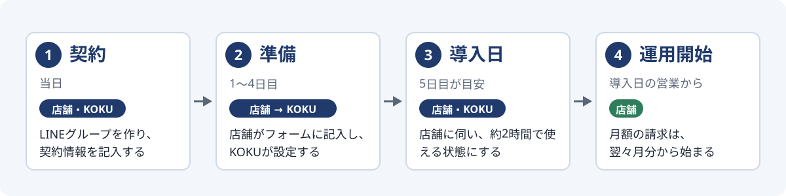
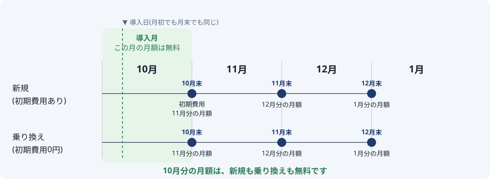
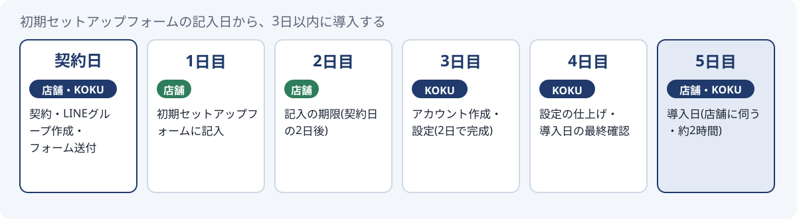
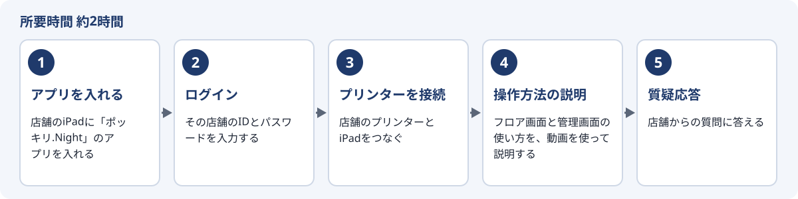

# ポッキリ.Night 契約フロー

契約から導入日までの流れと料金(社内・代理店向け)

この資料は、契約から導入日までに
誰が・いつ・何をするかをまとめたものです。

元データは `templates/contract/flow.yaml`。
直すときはYAMLを直し、再生成してください。

## 1. 全体の流れ



| 段階 | 誰が | いつ | すること |
|---|---|---|---|
| 契約 | 店舗・KOKU | 当日 | LINEグループを作り、契約情報を記入する |
| 準備 | 店舗 → KOKU | 1〜4日目 | 店舗がフォームに記入し、KOKUが設定する |
| 導入日 | 店舗・KOKU | 5日目が目安 | 店舗に伺い、約2時間で使える状態にする |
| 運用開始 | 店舗 | 導入日の営業から | 月額の請求は、翌々月分から始まる |

## 2. 料金

### 初期費用

| 区分 | 金額 |
|---|---|
| 新規 | 50,000円(税別) = 55,000円(税込) |
| 乗り換え | 0円 |

乗り換え(他社POSからの移行)は、初期費用がかかりません

### 月額(先払い)

| プラン | 月額 |
|---|---|
| ライトプラン | 30,000円(税込) |
| スタンダードプラン | 50,000円(税込) |

## 3. 請求のルール

- 月額は先払いです。月末に、翌月分の月額をいただきます
- 契約月(導入月)は、新規は初期費用だけをいただきます
- 乗り換えは初期費用が0円なので、契約月の請求はありません
- 導入した翌月分の月額は無料です(実質1か月無料)
- 月額の請求は、導入の翌月末に、翌々月分から始まります
- 月初に導入しても月末に導入しても、ルールは同じです

### 例: 10月に導入した場合



| 請求日 | 新規(初期費用あり) | 乗り換え(初期費用0円) |
|---|---|---|
| 10月末 | 初期費用 | 請求なし |
| 11月末 | 12月分の月額 | 12月分の月額 |
| 12月末 | 1月分の月額 | 1月分の月額 |

**11月分の月額は無料。請求は12月分から始まります**

## 4. 契約時にやること(その場で)

1. **LINEグループを作る**  
   店舗の担当者と、KOKUの担当を入れる
   KOKU側の招待: 蓮さん・秀美さん・山中・沢田
2. **契約情報をその場で記入してもらう**  
   下の「お客様契約情報」の項目を、LINEグループに書いてもらう
3. **導入日(店舗に伺う日)を決める**  
   理想はフォーム記入日から3日以内。契約日の5日後がベスト

### LINEグループに書いてもらう項目

会社とお店の連絡先だけを書いてもらいます。
キャストの個人情報は含めません。

```
【ポッキリ.Night】お客様契約情報
・会社名:
・会社住所・郵便番号:
・会社電話番号:
・代表者:
ーーーーーーーーーー
・店舗名:
・店舗住所:
・店舗電話番号:
・担当者:
・メールアドレス:
・請求方法: 『クレカ or 振込 or 口座振替』
・無料期間: (いつから請求が始まるかを書く)
```

## 5. 契約日から導入日までのスケジュール



| 日 | 誰が | すること |
|---|---|---|
| 契約日 | 店舗・KOKU | 契約・LINEグループ作成・フォーム送付 |
| 1日目 | 店舗 | 初期セットアップフォームに記入 |
| 2日目 | 店舗 | 記入の期限(契約日の2日後) |
| 3日目 | KOKU | アカウント作成・設定(2日で完成) |
| 4日目 | KOKU | 設定の仕上げ・導入日の最終確認 |
| 5日目 | 店舗・KOKU | 導入日(店舗に伺う・約2時間) |

- 店舗には「本日フォームを送るので明日までに記入を」と伝える
- 日程は店舗の忙しさで前後してよい。契約日の5日後がベスト
- フォームの設定内容は、KOKU側で2日あれば完成できる

## 6. 契約後にKOKU側がやること

1. **初期セットアップフォームを送る**  
   契約日に必ず、LINEグループで送る。送信後2日以内に記入してもらう
   https://pokkiri-night-survey.vercel.app
   - 商品メニューとキャスト情報は、店舗の方がPOSへ入力する
   - 商品メニューは、カテゴリー・商品名・販売価格・バックの4つ
   - 入力のやり方は、導入日に教える
2. **運営コンソールでアカウントを作る**  
   その店舗の名前で「新規追加」を押し、IDとパスワードを設定する
   - IDは店舗の名前を使う
   - パスワードの決め方は社内ルールに従い、この資料やLINEには書かない
3. **フォームの回答を取り込み、設定を作る**  
   回答をコンソールに貼り付けて取り込み、導入日までに設定を終える
   - 設定は2日あれば完成できる

## 7. 導入日にやること(約2時間)



1. **アプリを入れる**  
   店舗のiPadに「ポッキリ.Night」のアプリを入れる
2. **ログイン**  
   その店舗のIDとパスワードを入力する
   - IDとパスワードは、管理者が持っている
3. **プリンターを接続**  
   店舗のプリンターとiPadをつなぐ
4. **操作方法の説明**  
   フロア画面と管理画面の使い方を、動画を使って説明する
   - 管理画面で、メニューとキャストの追加を必ず促す
   - キャストの名前だけなら、iPadのタイムカードから登録できる
   - キャストの情報の入力は、管理画面から行う
5. **質疑応答**  
   店舗からの質問に答える

## 8. チェックリスト

### 契約時

- [ ] LINEグループを作り、担当者4名を招待した
- [ ] お客様契約情報を記入してもらった
- [ ] 請求方法と無料期間を確認した
- [ ] 導入日を決めた

### 契約後

- [ ] 契約日にフォームを送った
- [ ] 2日以内にフォームの記入が終わった
- [ ] アカウントを作った
- [ ] 設定を終えた

### 導入日

- [ ] アプリを入れてログインできた
- [ ] プリンターがつながった
- [ ] メニューとキャストの追加を案内した
- [ ] 質問に答えた

## 9. 未決事項

- パスワードの決め方(社内ルール)を別途まとめる。この資料には書かない
- 導入日より前に、店舗がメニューとキャストを入力できる手順を用意するか
